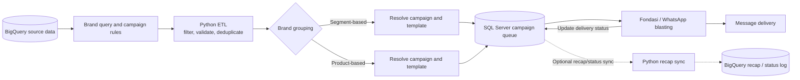
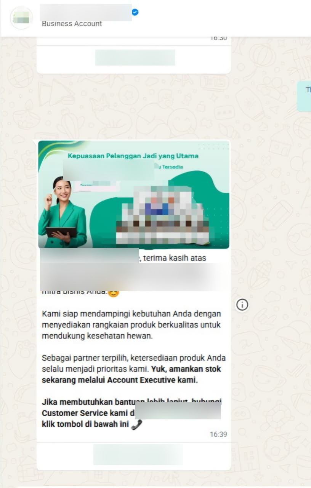
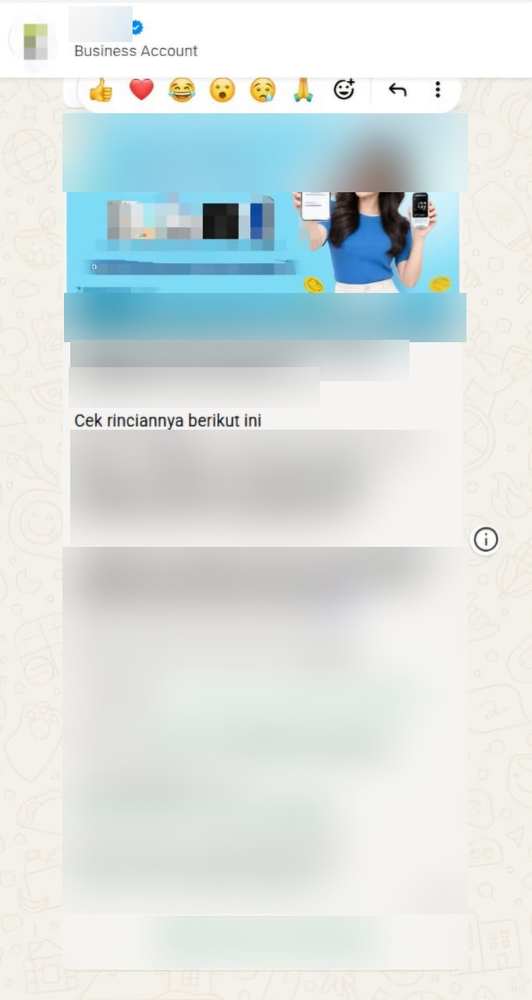

# Automation Campaign Push

A configurable WhatsApp campaign queue pipeline. It reads eligible campaign
records from BigQuery, transforms and validates them, then inserts queue rows
into a SQL Server table that is integrated with Fondasi and the WhatsApp
blasting process.

```text
BigQuery -> Python ETL -> SQL Server campaign queue -> Fondasi / WhatsApp blasting
```

This pipeline prepares and enqueues messages; the connected Fondasi/blasting
system processes the queue and handles message delivery and status updates.



Each brand's configuration determines its grouping dimension and campaign or
template mapping. For example, one flow may resolve these by segment, while
another resolves them by product. The dashed recap path is optional and uses
the configured BigQuery recap/status-log destinations.

## Architecture

- `main.py` coordinates campaign execution, checks, and retries.
- `core/` contains shared configuration, BigQuery access, data transformation,
  queue writing, alerting, and run logging.
- `brand/<brand>/` contains brand-specific source queries and campaign rules.
- `config/` contains the brand registry and SQL Server queue mapping.
- `.gitea/workflows/` contains scheduled and manually triggered automation.
- `tests/` is reserved for local test inputs; personal or company data files
  are excluded from this portfolio copy.

The registry currently uses the generic IDs `brand_1` and `brand_2` in
`config/brands.yaml`. `brand_1` is disabled and `brand_2` is enabled; only
enabled brands are available to run.

## Redacted result examples

The following screenshots illustrate example campaign results. Sender names
and logos, recipient-identifying details, brand references, phone numbers, and
links have been blurred; verified badges are left visible.





[`campaign_queue_recap_demo.xlsx`](examples/campaign_queue_recap_demo.xlsx)
contains synthetic examples of a `trwaqueue`-style SQL Server queue and
brand-specific recap rows. All row values are fabricated placeholders; it
contains no production records or contact details.

The pipeline uses a column contract for source queries:

| Field | Description |
|---|---|
| `outlet_id_source` | Source outlet/customer identifier. |
| `nama` | Optional name used when selecting a message template. |
| `nomor_wa` | WhatsApp number; normalized by the shared pipeline. |
| `segmen` | Optional brand-specific segment or grouping value. |
| `event_date` | Date associated with the source event. |

The required fields and grouping dimension vary by brand. For example, a
campaign may group records by segment, while another may group by product and
not use a segment field.

## External systems and placeholders

This portfolio copy uses generic identifiers instead of production resource
names:

- BigQuery references use `your-project.your_dataset.<table_name>`.
- The SQL Server host, database, schema, and queue table are placeholders in
  `config/queue.yaml`.
- Google Sheets IDs and tab names in the optional master-data sync scripts are
  placeholders.
- BigQuery recap and Fondasi status-log tables in brand configuration are
  placeholders.
- Campaign codes, campaign labels, sender/workspace identifiers, and message
  template names in brand configuration are placeholders as well.

Replace these values only in an authorized environment before running the
pipeline. The checked-in placeholders are examples, not valid production
configuration. Do not commit credentials, private endpoints, real customer
data, or company-specific resource names.

## Local setup

Use Python 3.11 or later. Copy `.env.example` to `.env`, then fill in values
locally using approved credentials. The example file is intentionally blank.
Keep real service-account files in the ignored `credentials/` folder; the
included JSON template is empty and cannot authenticate.

```powershell
py -m venv .venv
.\.venv\Scripts\Activate.ps1
py -m pip install -r requirements.txt
Copy-Item .env.example .env
```

Configure either the separate `QUEUE_DB_*` variables or `QUEUE_DB_URL`, not
both. Enable the appropriate SQL Server driver in `requirements.txt` if needed.
For BigQuery and Google Sheets access, use authorized service accounts.

## Running

The default mode for a selected brand is `execute`, which inserts records into
the configured SQL Server queue. Use `rollback` for a database transaction
test that is rolled back, and start with local sample files when possible.

```powershell
# List enabled brands
py main.py --list-brands

# Test transformation with an approved local input file
py main.py --brand <brand> --from-csv <approved-input-file.xlsx> --mode rollback

# Run a database rollback test
py main.py --brand <brand> --mode rollback

# Execute a campaign (writes to the configured queue)
py main.py --brand <brand> --mode execute
```

Other useful options include `--limit`, `--as-of`, `--tag`, `--since-hours`,
`check-results`, and `backfill-recap`. Review `py main.py --help` and the
brand-specific configuration before running. Do not execute against production
resources without authorization and an approved test plan.

## Docker

Docker Compose mounts brand configuration and local credentials into the
container. Credential files are mounted read-only and excluded from the build
context. Configure `.env` and authorized local credentials before using Docker.

```powershell
docker compose run --rm --build campaign-push --mode rollback
docker compose run --rm campaign-push --mode execute
docker compose run --rm campaign-push --mode check-results
```

## Gitea Actions

The workflows under `.gitea/workflows/` support scheduled and manual runs.
Configure a Linux runner and store runtime settings in repository Actions
Secrets; never put secret values in workflow files. Workflow schedules use
UTC. Check the workflow files and operational schedule before enabling them.

## Scope and safety

The code demonstrates a data-to-queue integration pattern. The generic table
identifiers, spreadsheet IDs, and connection settings must be configured for
an authorized environment. Local test spreadsheets are excluded because they may contain personal or
company data. Prepare an approved synthetic input file before using `--from-csv`.

This copy is not connected to BigQuery, SQL Server, Fondasi, or a WhatsApp
blasting service until valid authorized configuration and credentials are
provided.
